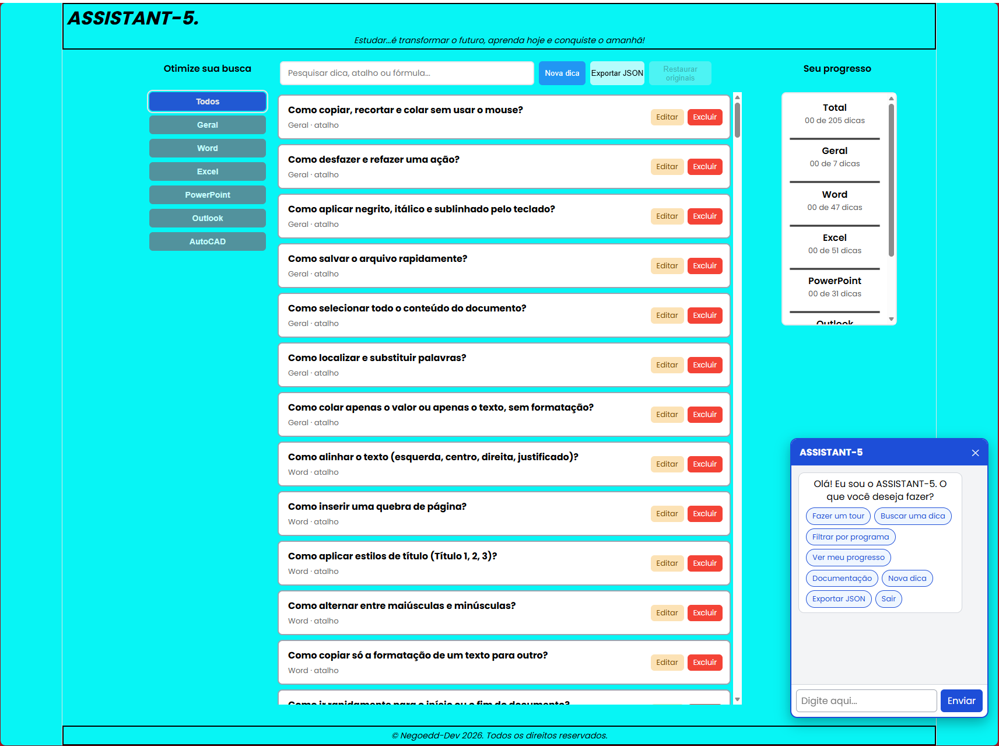

# ASSISTANT-5 · Dicas de Produtividade

Site de dicas de atalhos de teclado e fórmulas para qualquer programa (Windows, Office, AutoCad e etc), com busca, filtro e um assistente de chat que guia a visita.



**Demo:** _(https://assistant-5-tawny.vercel.app/)_

## Por que criei

Atalhos e fórmulas resolvem muito tempo de trabalho, mas ficam espalhados em anotações. Montei um lugar único para consultar, que aceita qualquer programa. Também faz parte dos meus estudos de desenvolvimento web com React.

## O que ele faz

- Lista de dicas em cards, com filtro por programa e busca por texto.
- Teclas e fórmulas em português e em inglês.
- Linha de progresso das dicas já lidas.
- Assistente de chat guiado: tour pelo projeto, busca, filtro, progresso e link para a documentação.
- Modo de edição (só em desenvolvimento): adicionar, editar e excluir dicas, com exportação e importação em JSON.

## Tecnologias

React, Vite, JavaScript, CSS. Dados em `dicas.json` e alterações salvas no `localStorage`.

## Como rodar

Requisito: [Node.js](https://nodejs.org) 18 ou superior.

```bash
git clone https://github.com/Negoedd-Dev/assistant-5
cd assistant-5
npm install
npm run dev
```

Abra o endereço que aparecer no terminal (normalmente http://localhost:5173).
Sem o Git, baixe o ZIP pelo botão verde **Code** desta página.

## Observações

- O **modo de edição** só aparece com `npm run dev`. No site publicado, a pessoa vê apenas o modo de leitura.
- As dicas ficam em `src/Dados/dicas.json`. Para ampliar a base, edite esse arquivo ou use a importação em JSON no modo de edição.

## Autor

Negoedd · [LinkedIn](https://www.linkedin.com/in/edson-nunes)
